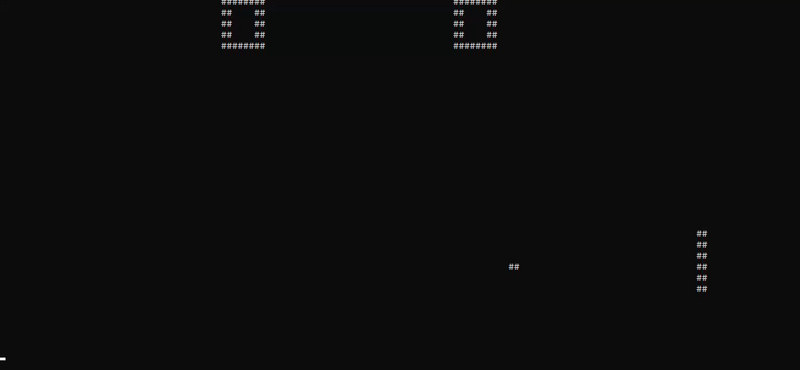

# CHIP-8 Interpreter

A CHIP-8 interpreter in C++ that runs entirely in the Windows console, with no graphics library and no dependencies beyond the Windows API for keyboard input. It plays Pong, passes the community CHIP-8 test suite, and can switch between original 1977 behaviour and modern behaviour.



This is the second in a series of from-scratch systems projects. The first is [Three Long Nights](https://github.com/wizzoc/three-long-nights), a console survival game. Next is a software rasterizer aimed at rendering Quake's first level.

## Highlights

- **Console rendering.** The 64×32 display is drawn as text at two characters per pixel, so images keep their proportions. Each frame is built as one string and written in a single console call, which keeps it flicker-free.
- **Switchable quirk profiles.** Several CHIP-8 instructions behave differently across historical interpreters. A *classic* profile matches the original COSMAC VIP on every quirk the community test suite checks; a *modern* profile matches what most newer ROMs expect.
- **Test-driven, one instruction group at a time.** Each group was checked against a register-check test ROM before the next was started, then the whole interpreter against [Timendus's CHIP-8 test suite](https://github.com/Timendus/chip8-test-suite).

## Status

**v1.0, complete.** All 34 standard instructions, 60 Hz timers, keyboard input, sound and both quirk profiles. (`0NNN`, which called native machine code on the original hardware, is reported as unknown, as in most modern interpreters.)

## Controls

The 16-key hex keypad maps onto the left side of the keyboard:

```
CHIP-8 keypad      Keyboard
1 2 3 C            1 2 3 4
4 5 6 D            Q W E R
7 8 9 E            A S D F
A 0 B F            Z X C V
```

## Bugs worth telling

**All 25 checks passed, and the program counter was still wrong.** After refactoring the decoder to extract each opcode field once, a test ROM reported every check passing, but the register dump showed the program counter at `0x154` instead of `0x2FA`. The 12-bit address field had been stored in an 8-bit variable. The ROM's final jump to `0x2FA` lost its top digit and went to `0xFA`, empty memory, and ran through 45 cycles of blank instructions. A cast I'd added had silenced the compiler warning that would have caught it. *Lesson: check every expected value, not just the pass count, and don't cast just to make a warning go away.*

**The flag that overwrote itself.** Arithmetic instructions write a carry or borrow flag into register `VF`, but a program can also target `VF` as the destination. My first version set the flag first and stored the result second, so when the destination *was* `VF`, the result overwrote the flag. A test that targets `VF` caught it. *Fix: copy the inputs first, store the result, and write the flag last.*

**Subtraction isn't addition in reverse.** I assumed the borrow flag would mirror the carry flag, 1 meaning "it borrowed." In CHIP-8 it's inverted: 1 means *no* borrow, inherited from the original hardware's CPU. *Lesson: when two operations look like a pair, read each spec separately.*

**Waiting for a key isn't the same as waiting for a key press.** `FX0A` pauses the program until a key is pressed. Mine returned the moment a key went down, and the community keypad test reported `NOT RELEASED`: the original hardware waits for the key to be pressed *and released*. *Fix: remember which key went down (with `-1` meaning none), keep waiting while it's held, and only hand it to the program on release.*

**The flicker was the clear.** The first renderer cleared the whole console every frame, then redrew it, and the screen flickered constantly. *Fix: never clear. Move the cursor back to the top-left corner and overwrite the previous frame in place, with the whole frame written in one call.*

## Quirk profiles

The profile is chosen at startup. Modern is the default.

| Behaviour | Classic (COSMAC VIP) | Modern |
|---|---|---|
| `8XY1` `8XY2` `8XY3`: logic ops (vF reset) | `VF` is set to 0 afterwards | `VF` untouched |
| `FX55` / `FX65`: store/load registers (memory) | `I` advances by X + 1 | `I` unchanged |
| `8XY6` / `8XYE`: shifts | `VX` = `VY` shifted | `VX` shifted in place |
| `DXYN`: draw (display wait) | At most one sprite per frame | No limit |
| `DXYN`: sprites at the screen edge | Clipped | Clipped |
| `BNNN`: jump with offset | Offset by `V0` | Offset by `V0` |

Older ROMs need classic; most newer ones expect modern. The profile is stored as a single setting because only two profiles exist. If a third is ever needed (SUPER-CHIP, for example), it would be split into one setting per quirk.

Also:
- Sprite start positions wrap around the screen.
- Stack overflow and underflow are reported instead of corrupting memory.
- Unknown opcodes are reported with their address instead of being silently ignored.

## Testing

| ROM | Covers | Result |
|---|---|---|
| `IBM Logo.ch8` | Loading, decoding, drawing, rendering | Logo renders correctly |
| `control-flow-test.ch8` | Calls and returns (two levels deep), all four conditional skips | Pass |
| `arithmetic-test.ch8` | The whole `8XY_` family, including carry/borrow flags and `VF` as a target | 21 / 21 |
| `misc-test.ch8` | `BNNN`, `CXNN`, `FX1E` `FX29` `FX33` `FX55` `FX65` | 25 / 25 |
| Timendus `3-corax+.ch8` | Every instruction's basic behaviour | All pass, both profiles |
| Timendus `4-flags.ch8` | Carry, borrow and shift flags, including `VF` as a target | All pass, both profiles |
| Timendus `5-quirks.ch8` (CHIP-8 mode) | vF reset, memory, display wait, clipping, shifting, jumping | Classic: all six pass. Modern: differs from the original exactly where intended |
| Timendus `6-keypad.ch8` | `EX9E`, `EXA1`, `FX0A` press and release | Pass |
| Timendus `7-beep.ch8` | The sound timer | Beeps (see limitations) |

The custom register-check ROMs are in `tests/`. The Timendus ROMs and Pong aren't included; the suite is linked above.

## Building and running

Windows only. Built with Visual Studio 2026 (MSVC, platform toolset v145).

1. Open the solution and build for x64.
2. Maximise the console window: the display needs at least 128×33 characters.
3. Run it, type a ROM path when prompted (e.g. `tests/IBM Logo.ch8`), then choose a profile: `0` for modern, `1` for classic.

## How it works

All machine state lives in one `Chip8` class: 4 KB of memory (font at `0x050`, programs at `0x200`), 16 eight-bit registers, a 16-bit index register and program counter, a 16-entry stack, two timers, and a 64×32 display stored as a flat array. The class uses only standard C++; the Windows-specific keyboard polling lives in `main.cpp`.

**Each cycle** fetches two bytes and combines them into a 16-bit opcode, advances the program counter, extracts every opcode field once, then dispatches on the first hex digit. The `0`, `8`, `E` and `F` families dispatch a second time on their remaining digits.

**Each frame** (about 60 per second):
1. Poll the keyboard.
2. Run up to 10 instructions. Under the classic profile, a draw ends the batch early, which reproduces the original hardware waiting for the screen refresh.
3. Check the sound timer, and ring the console bell when it switches from 0 to above 0.
4. Tick both timers down.
5. Render, then sleep 16 ms.

## Known limitations

- **Timing** uses a fixed 16 ms sleep, so the interpreter runs slightly slower than 60 Hz.
- **Sound** uses the console bell, which plays the same short ding every time, so long and short beeps sound alike.
- **Windows only,** because of the keyboard polling.

## About this project

I wrote the interpreter code myself, with one exception: for `FX0A` (wait for a key press and release), Claude (Anthropic) showed me a reference implementation after I got stuck, which I then integrated. Otherwise I used Claude as a mentor and code reviewer: it explained concepts, reviewed my code and plans, and generated the custom register-check test ROMs. The IBM logo ROM is a widely distributed CHIP-8 test program, and the community test suite is by Timendus.

References: Cowgod's *Chip-8 Technical Reference v1.0*; Tobias V. Langhoff, *Guide to making a CHIP-8 emulator*; Timendus, *CHIP-8 test suite*.
